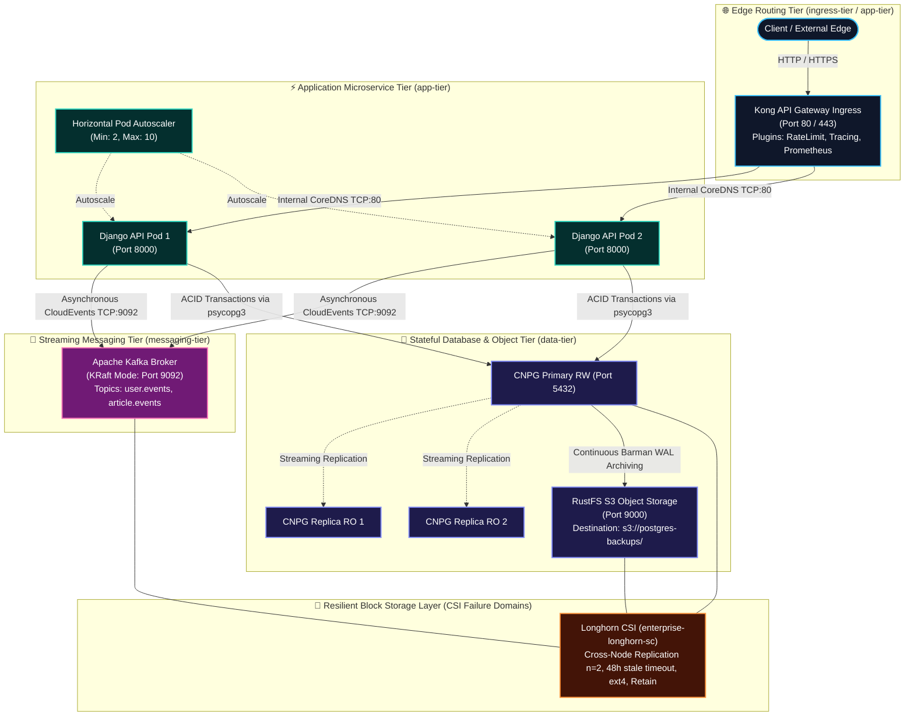
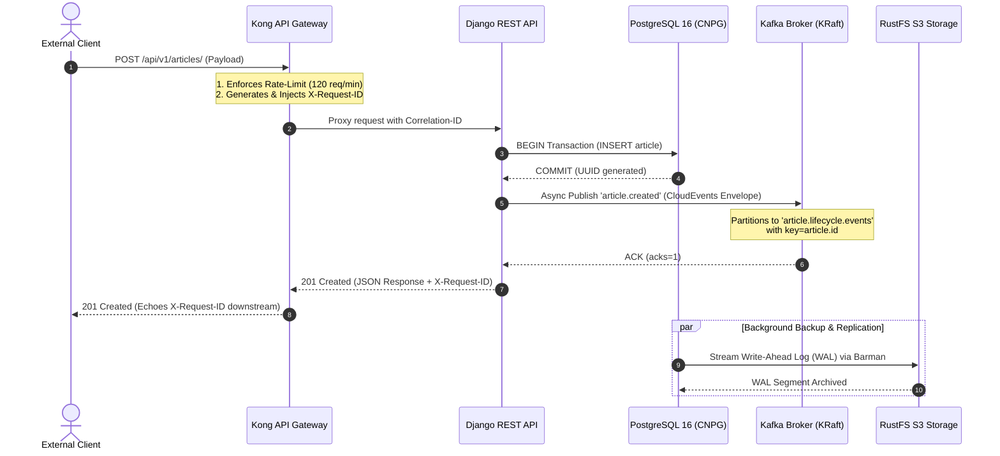
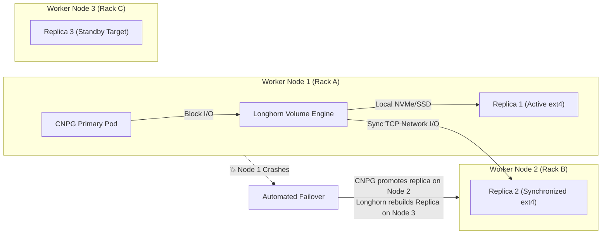
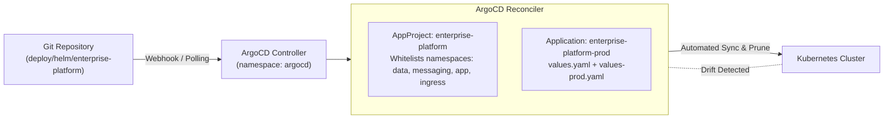
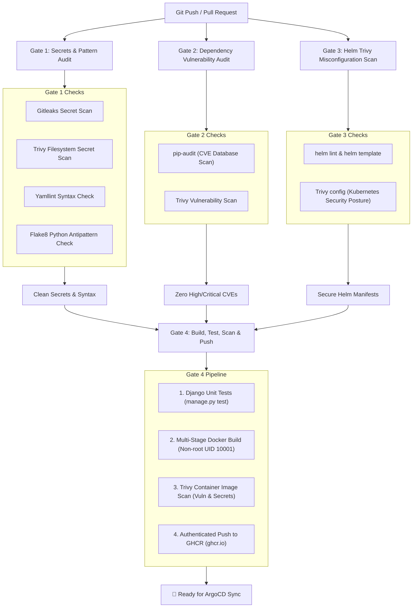

# 🚀 Enterprise Event-Driven Micro-Platform (EEMP)

### Resilient Cloud-Native Architecture Blueprint, Helm 3, ArgoCD GitOps & DevSecOps Suite

[](.github/workflows/ci.yaml)
[](https://helm.sh)
[](https://argo-cd.readthedocs.io/)
[](https://trivy.dev/)
[](https://kubernetes.io)
[](https://www.postgresql.org/)
[](https://kafka.apache.org/)
[](https://www.djangoproject.com/)
[](https://longhorn.io/)

---

## 📌 Executive Summary (The 30-Second Elevator Pitch)

> **What is this project?**
> The **Enterprise Event-Driven Micro-Platform (EEMP)** is a complete, battle-tested blueprint for running mission-critical stateful microservices on Kubernetes.
>
> It provides an automated, zero-trust control plane integrating:
>
> 1. **Distributed Block Storage** with cross-node replication (**Longhorn CSI**).
> 2. **High-Availability PostgreSQL 16** with automated failover and continuous S3 WAL archiving (**CloudNativePG** + **RustFS S3**).
> 3. **Next-Gen Distributed Streaming** in native ZooKeeper-less mode (**Apache Kafka KRaft**).
> 4. **Resilient Application Microservice** emitting asynchronous CloudEvents envelopes (**Django REST Framework** + **Psycopg 3**).
> 5. **Edge Routing & Policy Enforcement** with rate-limiting and correlation ID tracing (**Kong API Gateway**).
> 6. **Declarative GitOps Continuous Delivery** (**ArgoCD** + **Helm 3**).
> 7. **Shift-Left DevSecOps** with automated secret detection (**Gitleaks**), CVE auditing (**pip-audit**), and Kubernetes misconfiguration scanning (**Trivy**).

---

## 🗺️ High-Level System Architecture

The platform separates compute, storage, messaging, and routing into isolated failure domains governed by Kubernetes NetworkPolicies:



---

## 🔄 End-to-End Request & Event Lifecycle

This sequence diagram illustrates what happens when a client sends an API request (e.g., publishing a new enterprise article):



---

## 🛡️ Failure Domains & Physical Storage Replication (Longhorn)

How does the platform survive sudden hardware node loss without data corruption?



- **Longhorn CSI StorageClass (`enterprise-longhorn-sc`)**:
  - `numberOfReplicas: "2"`: Guarantees synchronous multi-node persistence.
  - `volumeBindingMode: Immediate`: Provisions storage instantly to match scheduling requirements.
  - `reclaimPolicy: Retain`: Prevents catastrophic data deletion if pods or PVCs are unbound.
  - `staleReplicaTimeout: "2880"` (48 Hours): Avoids immediate disk thrashing during temporary node restarts.

---

## 🔒 Zero-Trust Network & Data Flow Matrix

Every tier is locked down using Kubernetes `NetworkPolicy` objects that deny all unauthorized cross-namespace lateral movement:

| Source Layer          | Destination Layer | Protocol / Port         | OSI Layer | Functional Role                                | Security Policy Rule                                                  |
| :-------------------- | :---------------- | :---------------------- | :-------- | :--------------------------------------------- | :-------------------------------------------------------------------- |
| **Client / Internet** | **Kong Ingress**  | `HTTP/HTTPS (80/443)`   | Layer 7   | Inbound traffic, TLS termination, DDoS defense | Edge Firewall & TLS Ingress                                           |
| **Kong Ingress**      | **Django API**    | `TCP (Port 80 → 8000)`  | Layer 4/7 | CoreDNS upstream proxying                      | `app-tier-network-policy` restricts ingress strictly to Kong          |
| **Django API**        | **CNPG Postgres** | `TCP (Port 5432)`       | Layer 4   | Relational ACID queries via `psycopg3`         | `postgres-network-policy` allows port 5432 **only** from `django-api` |
| **Django API**        | **Kafka Broker**  | `TCP (Port 9092)`       | Layer 4   | Non-blocking CloudEvents streaming             | `kafka-network-policy` allows port 9092 **only** from `django-api`    |
| **CNPG Primary**      | **RustFS S3**     | `HTTP REST (Port 9000)` | Layer 7   | Continuous WAL archiving & base backups        | `rustfs-network-policy` allows port 9000 **only** from `data-tier`    |

---

## ⚙️ Declarative GitOps Architecture (ArgoCD & Helm)

The platform follows a strict **GitOps** operating model. Nothing is applied manually with `kubectl` in production; the Git repository is the single source of truth.



### GitOps Features Configured:

- **`selfHeal: true`**: If an engineer manually alters a pod or service with `kubectl`, ArgoCD immediately detects the configuration drift and reverts the cluster back to the Git state.
- **`prune: true`**: Removing a manifest or template from Git automatically cleans up the stale Kubernetes object.
- **`ApplyOutOfSyncOnly: true`**: Highly efficient reconciliation that only updates resources whose declarative spec has changed.

---

## 🛡️ DevSecOps CI/CD Pipeline & Shift-Left Security

Every code change must pass four automated security and quality gates before being deployed:



---

## 💡 Top Architectural Trade-offs (Interview Cheatsheet)

When asked why this platform was designed this way, here are the key technical decisions:

```
┌─────────────────────────────────┬──────────────────────────────────┬────────────────────────────────────────────────────────┐
│ Engineering Decision            │ Alternative Considered           │ Why We Made This Choice                                │
├─────────────────────────────────┼──────────────────────────────────┼────────────────────────────────────────────────────────┤
│ Apache Kafka in KRaft Mode      │ Kafka with Apache ZooKeeper      │ Eliminates ZooKeeper operational overhead; metadata is │
│                                 │                                  │ managed internally via Raft, dramatically simplifying  │
│                                 │                                  │ controller failovers and reducing memory footprint.    │
├─────────────────────────────────┼──────────────────────────────────┼────────────────────────────────────────────────────────┤
│ CloudNativePG (CNPG)            │ Standard PostgreSQL StatefulSet  │ Built specifically for Kubernetes; handles automated   │
│                                 │ or external managed DB           │ failover, standby election, online backup replication, │
│                                 │                                  │ and rolling minor upgrades with zero manual downtime.  │
├─────────────────────────────────┼──────────────────────────────────┼────────────────────────────────────────────────────────┤
│ Longhorn CSI Distributed Storage│ HostPath / NFS / Cloud Volumes   │ Vendor-agnostic, open-source block storage that runs   │
│                                 │                                  │ on any bare-metal or cloud k8s cluster with cross-node │
│                                 │                                  │ synchronous mirroring (n=2) and snapshots.             │
├─────────────────────────────────┼──────────────────────────────────┼────────────────────────────────────────────────────────┤
│ RustFS / S3 WAL Offloading      │ Local disk volume archiving      │ S3-compatible, memory-safe off-cluster storage ensures  │
│                                 │                                  │ PostgreSQL can execute Point-In-Time-Recovery (PITR)   │
│                                 │                                  │ even if all PostgreSQL worker nodes are wiped out.     │
├─────────────────────────────────┼──────────────────────────────────┼────────────────────────────────────────────────────────┤
│ Asynchronous CloudEvents Buffer │ Synchronous HTTP Webhooks        │ Decouples write transactions from downstream consumers;│
│                                 │                                  │ prevents API latency spikes if downstream message      │
│                                 │                                  │ processors slow down or crash.                         │
└─────────────────────────────────┴──────────────────────────────────┴────────────────────────────────────────────────────────┘
```

---

## ⚡ Quickstart Guide (Run & Verify in 3 Minutes)

### Option A: Local Full-Stack Emulation (Docker Compose)

Experience the complete 5-tier architecture locally on your laptop without needing a Kubernetes cluster:

```bash
# 1. Start all tiers in the background (RustFS, Postgres 16, Kafka KRaft, Django, Kong)
docker compose up -d --build

# 2. Check running services
docker compose ps

# 3. Verify health & readiness probes
curl -i http://localhost:8000/healthz/
curl -i http://localhost:8000/readyz/

# 4. Execute the automated end-to-end smoke test
python scripts/smoke-test.py --base-url http://localhost:8000

# 5. Stop and tear down
docker compose down -v
```

---

### Option B: Kubernetes Deployment via Helm 3

Deploy the platform to any Kubernetes cluster (Minikube, Kind, EKS, GKE, AKS, or bare metal):

```bash
# 1. Inspect and lint the Helm chart
python scripts/validate-helm.py

# 2. Deploy via Helm
helm upgrade --install enterprise-platform deploy/helm/enterprise-platform \
  --values deploy/helm/enterprise-platform/values.yaml

# 3. Verify pod status across namespaces
kubectl get pods -n data-tier
kubectl get pods -n messaging-tier
kubectl get pods -n app-tier
```

---

### Option C: Declarative GitOps via ArgoCD

Synchronize directly from Git:

```bash
# 1. Register the AppProject
kubectl apply -f deploy/argocd/appproject.yaml

# 2. Deploy the ArgoCD Application
kubectl apply -f deploy/argocd/application.yaml

# 3. Watch ArgoCD synchronize all tiers
kubectl -n argocd get application enterprise-platform-prod
```

---

## 🧪 Automated Testing & Security Validation Commands

Run the full local audit suite to test code quality, secrets, dependencies, and Kubernetes manifests:

```bash
# 1. Local DevSecOps Audit (Secrets, Antipatterns, Dependencies)
python scripts/security-scan.py

# 2. Helm Chart Syntax & Template Block Balance Check
python scripts/validate-helm.py

# 3. Raw Kubernetes Manifest & Kustomize Compilation Validator
python scripts/validate-manifests.py

# 4. Django Application Unit & Integration Tests (100% pass)
cd src/django-enterprise-api
python manage.py test
```

---

## 📂 Repository Directory Layout

```
cloud-native-resilient-blueprint/
├── .github/
│   └── workflows/
│       └── ci.yaml                       # DevSecOps CI/CD Pipeline (Trivy, Gitleaks, Test, Build, Push)
├── .gitleaks.toml                        # Gitleaks rule configuration & allowlists
├── .yamllint.yml                         # YAML formatting and pattern rules
├── config/kong/kong.yml                  # Declarative Kong Gateway configuration
├── deploy/
│   ├── argocd/                           # Declarative GitOps ArgoCD Manifests
│   │   ├── appproject.yaml               # ArgoCD AppProject with destination namespace constraints
│   │   ├── application.yaml              # Production ArgoCD Application (tracking Helm)
│   │   └── application-dev.yaml          # Development ArgoCD Application
│   ├── helm/enterprise-platform/         # Enterprise Platform Helm 3 Chart
│   │   ├── Chart.yaml                    # Helm chart metadata
│   │   ├── values.yaml                   # Base values & parameterization
│   │   ├── values-dev.yaml               # Dev environment overrides
│   │   ├── values-prod.yaml              # Production environment overrides
│   │   ├── .helmignore                   # Helm packaging ignore list
│   │   └── templates/                    # Parameterized multi-tier templates
│   │       ├── _helpers.tpl              # Shared template helpers
│   │       ├── 00-infrastructure/        # StorageClass, Namespaces, NetworkPolicies
│   │       ├── 01-data-tier/             # RustFS, CNPG Cluster, S3 Backups
│   │       ├── 02-messaging-tier/        # Apache Kafka KRaft StatefulSet & Topics
│   │       ├── 03-app-tier/              # Django API Deployment, Service, HPA, PDB
│   │       ├── 04-edge-routing/          # KongIngress, Ingress, Rate-limiting, Tracing
│   │       └── NOTES.txt                 # Post-install cluster instructions
│   └── kubernetes/                       # Standard Kustomize tiered manifests
├── docs/
│   ├── architecture.md                   # Full architecture deep-dive & sequence diagrams
│   ├── argocd-gitops.md                  # Comprehensive ArgoCD GitOps setup & operations
│   ├── disaster-recovery.md              # Database PITR, Kafka quorum, Longhorn rebuild
│   └── runbooks/
│       ├── operations.md                 # Scaling, secrets rotation, volume expansion
│       └── verification.md               # QA checklist and manual verification
├── scripts/
│   ├── security-scan.py                  # Local DevSecOps secret, pattern & dependency scanner
│   ├── validate-helm.py                  # Helm chart structure and template syntax validator
│   ├── validate-manifests.py             # Manifest specification & syntax validator
│   ├── smoke-test.py                     # End-to-end integration smoke test runner
│   ├── deploy.sh / deploy.ps1            # Multi-tier deployment orchestrators
│   └── teardown.sh                       # Teardown utility
├── src/django-enterprise-api/            # Django REST Framework Microservice
│   ├── apps/                             # Core (Kafka Producer, Health, Tracing), Articles, Users
│   ├── enterprise_platform/              # Settings (psycopg3, 12-factor), URLs, WSGI, ASGI
│   ├── tests/                            # Unit and integration test suite (9 tests)
│   ├── Dockerfile                        # Multi-stage production container build
│   ├── entrypoint.sh                     # DB wait, migrations, static collection, gunicorn
│   └── requirements.txt                  # Pinned Python dependencies
├── docker-compose.yml                    # Local multi-tier environment emulator
├── .env.example                          # Environment template
├── Makefile                              # Developer convenience targets
└── README.md                             # Platform documentation
```

---

## 👨‍💻 Author & Architecture Team

Architected by the **Platform Reliability & Cloud-Native Engineering Team**.  
Licensed under the **Apache 2.0 License**.
