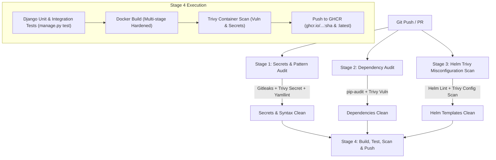

# Enterprise Event-Driven Micro-Platform (EEMP)
### Cloud-Native Resilient Architecture Blueprint, Helm 3 & ArgoCD GitOps Suite

[](.github/workflows/ci.yaml)
[](https://helm.sh)
[](https://argo-cd.readthedocs.io/)
[](https://trivy.dev/)
[](https://kubernetes.io)
[](https://www.postgresql.org/)
[](https://kafka.apache.org/)
[](https://www.djangoproject.com/)
[](https://longhorn.io/)

---

## 1. Executive Summary & Architectural Overview

The **Enterprise Event-Driven Micro-Platform (EEMP)** is a production-grade, highly available Kubernetes deployment blueprint integrating cloud-native distributed storage, real-time message streaming, edge gateway routing, relational database clustering with automated failover, declarative GitOps automation with **ArgoCD & Helm**, and **Trivy DevSecOps** continuous security scanning.

```
                              [ EXTERNAL CLIENT TRAFFIC ]
                                           │
                                  HTTP/HTTPS (Port 80/443)
                                           ▼
             ╔═════════════════════════════════════════════════════════════╗
             ║ EDGE ROUTING LAYER: Kong API Gateway Ingress (app-tier)     ║
             ║ Host: api.enterprise.local  │ Plugins: RateLimit, Tracing  ║
             ╚═════════════════════════════╤═══════════════════════════════╝
                                           │
                               TCP CoreDNS (Port 80 -> 8000)
                                           ▼
             ╔═════════════════════════════════════════════════════════════╗
             ║ APPLICATION LAYER: Django REST Framework (app-tier)         ║
             ║ Replicas: 2 (HPA / PDB) │ Psycopg3 │ Telemetry Publisher    ║
             ╚═══════════════════╤═════════════════════╤═══════════════════╝
                                 │                     │
                     TCP (Port 5432)              TCP (Port 9092)
                                 │                     │
                                 ▼                     ▼
 ╔═══════════════════════════════════════════╗  ╔════════════════════════════════════╗
 ║ STATEFUL DB LAYER: CloudNativePG (CNPG)   ║  ║ EVENT STREAMING: Apache Kafka      ║
 ║ 3 HA Instances │ Auto Failover            ║  ║ KRaft Mode (messaging-tier)        ║
 ║ Primary RW: postgres-cluster-rw           ║  ║ Topics: user / article events      ║
 ╚═══════════════════════════════╤═══════════╝  ╚══════════════════╤═════════════════╝
                                 │                                 │
                     S3 Barman WAL (Port 9000)                     │
                                 ▼                                 │
 ╔═══════════════════════════════════════════╗                     │
 ║ OBJECT STORAGE: RustFS S3 (data-tier)     ║                     │
 ║ 50Gi Longhorn PV │ WAL & Media Repo       ║                     │
 ╚═══════════════════════════════╤═══════════╝                     │
                                 │                                 │
 ════════════════════════════════╪═════════════════════════════════╪══════════════════
               GLOBAL CSI STORAGE: Longhorn (enterprise-longhorn-sc)
            Cross-Node Replication (n=2, 48h stale timeout, ext4, Retain)
 ═════════════════════════════════════════════════════════════════════════════════════
```

---

## 2. DevSecOps CI/CD Pipeline Architecture

The automated GitHub Actions workflow (`.github/workflows/ci.yaml`) enforces zero-trust security and quality gates:



### DevSecOps Controls:
1. **Hardcoded Secret Detection:** Gitleaks and Trivy filesystem scans block accidental token/credential leaks using `.gitleaks.toml`.
2. **Pattern & File Integrity:** Yamllint and Flake8 ensure consistent indentation, code conventions, and check for forbidden antipatterns.
3. **Dependency CVE Auditing:** `pip-audit` checks Python dependencies against national vulnerability databases.
4. **Helm Misconfiguration Scanning:** Trivy config scan inspects all Kubernetes and Helm templates for security context issues, root execution, and missing resource limits.
5. **Container Image Scanning & Push:** Multi-stage image build, scanned with Trivy before publication to GitHub Packages (`ghcr.io`).

---

## 3. Declarative GitOps with ArgoCD & Helm

The entire platform is packaged as a Helm 3 chart in `deploy/helm/enterprise-platform/` and tracked declaratively by ArgoCD.

### 3.1 Bootstrap ArgoCD AppProject
```bash
kubectl apply -f deploy/argocd/appproject.yaml
```

### 3.2 Bootstrap ArgoCD Helm Application
```bash
# Production Application (values.yaml + values-prod.yaml)
kubectl apply -f deploy/argocd/application.yaml

# Development Application (values.yaml + values-dev.yaml)
kubectl apply -f deploy/argocd/application-dev.yaml
```

ArgoCD maintains automated synchronization, self-healing (`selfHeal: true`), and automated pruning (`prune: true`) across all 4 tier namespaces.

---

## 4. Local Development & Security Verification

You can execute the entire DevSecOps security and quality suite locally before pushing:

```bash
# 1. Run local DevSecOps security, secret, and dependency audit
python scripts/security-scan.py

# 2. Validate Helm chart templates and values syntax
python scripts/validate-helm.py

# 3. Validate raw Kubernetes manifests and Kustomize assembly
python scripts/validate-manifests.py

# 4. Run Django application unit and integration tests
cd src/django-enterprise-api
python manage.py test

# 5. Spin up full multi-tier local environment emulator
docker compose up -d --build
```

---

## 5. Repository Directory Layout

```
cloud-native-resilient-blueprint/
├── .github/
│   └── workflows/
│       └── ci.yaml                       # DevSecOps CI/CD Pipeline (Trivy, Gitleaks, Test, Build, Push)
├── .gitleaks.toml                        # Gitleaks rule configuration & allowlists
├── .yamllint.yml                         # YAML formatting and pattern rules
├── config/kong/kong.yml                  # Declarative Kong Gateway configuration
├── deploy/
│   ├── argocd/                           # Declarative GitOps ArgoCD Manifests
│   │   ├── appproject.yaml               # ArgoCD AppProject with destination namespace constraints
│   │   ├── application.yaml              # Production ArgoCD Application (tracking Helm)
│   │   └── application-dev.yaml          # Development ArgoCD Application
│   ├── helm/enterprise-platform/         # Enterprise Platform Helm 3 Chart
│   │   ├── Chart.yaml                    # Helm chart metadata
│   │   ├── values.yaml                   # Base values & parameterization
│   │   ├── values-dev.yaml               # Dev environment overrides
│   │   ├── values-prod.yaml              # Production environment overrides
│   │   ├── .helmignore                   # Helm packaging ignore list
│   │   └── templates/                    # Parameterized multi-tier templates
│   │       ├── _helpers.tpl              # Shared template helpers
│   │       ├── 00-infrastructure/        # StorageClass, Namespaces, NetworkPolicies
│   │       ├── 01-data-tier/             # RustFS, CNPG Cluster, S3 Backups
│   │       ├── 02-messaging-tier/        # Apache Kafka KRaft StatefulSet & Topics
│   │       ├── 03-app-tier/              # Django API Deployment, Service, HPA, PDB
│   │       ├── 04-edge-routing/          # KongIngress, Ingress, Rate-limiting, Tracing
│   │       └── NOTES.txt                 # Post-install cluster instructions
│   └── kubernetes/                       # Standard Kustomize tiered manifests
├── docs/
│   ├── architecture.md                   # Full architecture deep-dive & sequence diagrams
│   ├── argocd-gitops.md                  # Comprehensive ArgoCD GitOps setup & operations
│   ├── disaster-recovery.md              # Database PITR, Kafka quorum, Longhorn rebuild
│   └── runbooks/
│       ├── operations.md                 # Scaling, secrets rotation, volume expansion
│       └── verification.md               # QA checklist and manual verification
├── scripts/
│   ├── security-scan.py                  # Local DevSecOps secret, pattern & dependency scanner
│   ├── validate-helm.py                  # Helm chart structure and template syntax validator
│   ├── validate-manifests.py             # Manifest specification & syntax validator
│   ├── smoke-test.py                     # End-to-end integration smoke test runner
│   ├── deploy.sh / deploy.ps1            # Multi-tier deployment orchestrators
│   └── teardown.sh                       # Teardown utility
├── src/django-enterprise-api/            # Django REST Framework Microservice
│   ├── apps/                             # Core (Kafka Producer, Health, Tracing), Articles, Users
│   ├── enterprise_platform/              # Settings (psycopg3, 12-factor), URLs, WSGI, ASGI
│   ├── tests/                            # Unit and integration test suite (9 tests)
│   ├── Dockerfile                        # Multi-stage production container build
│   ├── entrypoint.sh                     # DB wait, migrations, static collection, gunicorn
│   └── requirements.txt                  # Pinned Python dependencies
├── docker-compose.yml                    # Local multi-tier environment emulator
├── .env.example                          # Environment template
├── Makefile                              # Developer convenience targets
└── README.md                             # Platform documentation
```

---

## 6. License & Maintenance
Maintained by the Enterprise Architecture & Platform Reliability Team.
Licensed under the Apache 2.0 License.
