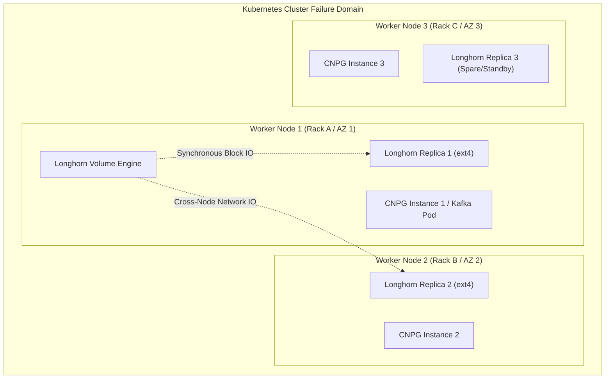
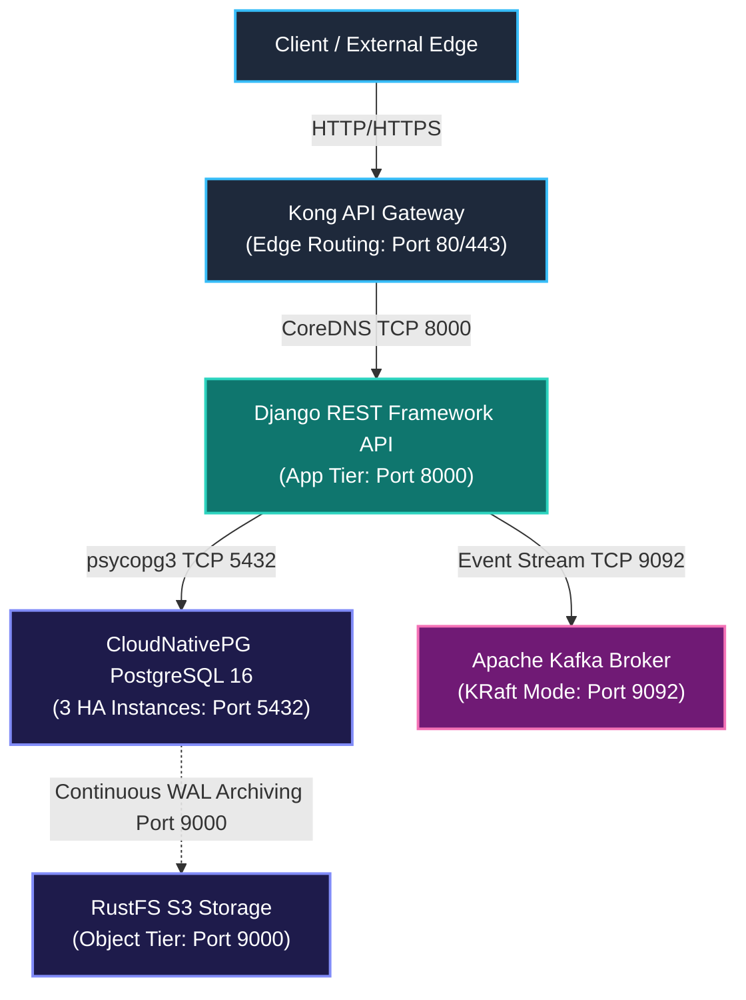

# System Architecture Deep Dive: Enterprise Event-Driven Micro-Platform (EEMP)

This specification defines the formal engineering architecture for deploying the Enterprise Event-Driven Micro-Platform across high-availability Kubernetes clusters.

---

## 1. Global Infrastructure & Storage Topology (Longhorn & Cross-Node Replication)

### 1.1 Storage Orchestration & CSI Driver
Longhorn serves as the cloud-native Container Storage Interface (CSI) plugin, pooling block storage distributed across Kubernetes worker nodes into resilient, fault-tolerant block volumes.

### 1.2 Storage Isolation & Node Anti-Affinity
* **Replication Factor ($n=2$ / $n=3$):** Stateful volumes for CloudNativePG (20Gi), Kafka (15Gi), and RustFS (50Gi) are provisioned via `enterprise-longhorn-sc`.
* **Failure Domain Isolation:** Replicas are scheduled across discrete physical or virtual nodes (`numberOfReplicas: "2"` with `staleReplicaTimeout: "2880"`). Even if an entire node experiences a sudden power loss or hardware failure, the remaining replica maintains continuous data availability without IO corruption.
* **Volume Expansion & Reclaim:** Dynamic volume expansion (`allowVolumeExpansion: true`) enables scaling persistent storage without cluster downtime. Volumes are retained on release (`reclaimPolicy: Retain`) to prevent accidental data loss.

---

## 2. Component Specifications & Declarative Architecture

### 2.1 Object Storage Layer: RustFS
* **Purpose:** S3-compatible, memory-safe high-performance storage engine.
* **Responsibilities:**
  - WAL (Write-Ahead Log) archiving from the CloudNativePG PostgreSQL cluster.
  - Scheduled base backups (`postgres-daily-backup`).
  - Storage repository for static assets and Django media uploads.
* **Persistence:** Provisioned with a 50Gi Longhorn volume (`rustfs-data`) mounted at `/data`.
* **Service Resolution:** Exposed internally as `rustfs-service.data-tier.svc.cluster.local:9000` with headless binding `rustfs-headless`.

### 2.2 Stateful Database Layer: CloudNativePG (CNPG)
* **Purpose:** Production-grade PostgreSQL 16 HA cluster with unsupervised automated failover.
* **Topology:** 3 pods (`postgres-cluster-1`, `postgres-cluster-2`, `postgres-cluster-3`).
* **Connection Routing:**
  - Primary Read-Write: `postgres-cluster-rw.data-tier.svc.cluster.local:5432`
  - Read-Only Replicas: `postgres-cluster-ro.data-tier.svc.cluster.local:5432`
* **Backup & Continuous Archiving:** Barman object store integration streaming PostgreSQL WAL files continuously to `s3://postgres-backups/` on RustFS.

### 2.3 Event Streaming Layer: Apache Kafka (KRaft Mode)
* **Architecture:** Kafka 3.6 / Confluent 7.6 running in native KRaft mode (Kafka Raft Metadata mode without ZooKeeper).
* **Quorum & Metadata:**
  - Controller Quorum: `1@kafka-broker-0.kafka-headless.messaging-tier.svc.cluster.local:9093`
  - Client Listener: `0.0.0.0:9092` (`PLAINTEXT`)
  - Controller Listener: `0.0.0.0:9093` (`CONTROLLER`)
* **Topics:**
  - `user.lifecycle.events` (3 partitions, replication factor 1/2)
  - `article.lifecycle.events` (3 partitions, replication factor 1/2)

### 2.4 Application Layer: Django REST Framework
* **Stateless Microservice:** Scaled horizontally across 2+ replicas with Pod Disruption Budget (`minAvailable: 1`) and Horizontal Pod Autoscaler.
* **Database Access:** High-performance asynchronous and pooled database connections using PostgreSQL 16 and `psycopg3`.
* **Telemetry & Event Publishing:**
  - Thread-safe `EnterpriseKafkaProducer` emitting structured CloudEvents envelopes.
  - Generates and echoes `X-Request-ID` correlation identifiers across all API boundaries.
  - Exposes Kubernetes liveness (`/healthz/`), readiness (`/readyz/`), and Prometheus telemetry (`/metrics/`).

### 2.5 Edge Routing Layer: Kong API Gateway
* **Ingress Management:** Ingress controller directing inbound external traffic matching `api.enterprise.local` to `django-service` on port 80.
* **Gateway Plugins:**
  - **Rate Limiting:** Prevents DDoS and resource exhaustion (120 req/min).
  - **Correlation ID:** Generates/propagates `X-Request-ID` across downstream services.
  - **Prometheus:** Real-time edge latency, bandwidth, and HTTP status code metrics.

---

## 3. Network & Data Flow Architecture Matrix

| Source Layer | Destination Layer | Protocol / Port | OSI Layer | Functional Description | Security Policy Enforcement |
| :--- | :--- | :--- | :--- | :--- | :--- |
| **Client / Edge** | **Kong Ingress** | HTTP/HTTPS (Port 80/443) | Layer 7 | External traffic entry point, TLS termination, rate-limiting, and path routing. | Edge firewall & Ingress TLS rules |
| **Kong Ingress** | **Django Service** | TCP (Port 80 → 8000) | Layer 4/7 | Internal cluster upstream proxying via Kubernetes CoreDNS resolution (`ClusterIP`). | `app-tier-network-policy` allows port 8000 from ingress namespaces |
| **Django Service** | **CNPG Postgres** | TCP (Port 5432) | Layer 4 | ORM-backed relational transactions, connection pooling, and ACID persistence over Longhorn volumes. | `postgres-network-policy` restricts port 5432 strictly to `app.kubernetes.io/name: django-api` |
| **Django Service** | **Kafka Broker** | TCP (Port 9092) | Layer 4 | Asynchronous publishing of user/article event streams. | `kafka-network-policy` restricts port 9092 strictly to `app.kubernetes.io/name: django-api` |
| **CNPG Operator** | **RustFS S3** | HTTP REST (Port 9000) | Layer 7 | Automated Write-Ahead Log (WAL) archiving and scheduled base backups. | `rustfs-network-policy` restricts port 9000 to CNPG cluster pods |
