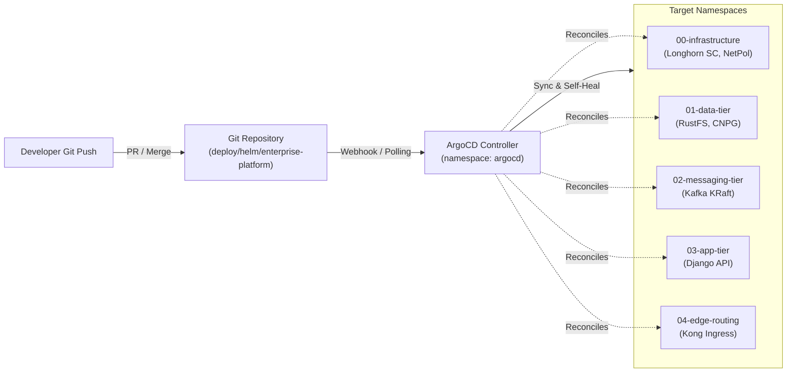

# Declarative GitOps with ArgoCD & Helm

This guide outlines how to manage and continuously deploy the **Enterprise Event-Driven Micro-Platform (EEMP)** using ArgoCD and the Helm chart repository.

---

## 1. Architectural Overview



---

## 2. Installing ArgoCD in the Cluster

If ArgoCD is not yet provisioned in your Kubernetes cluster:

```bash
# 1. Create ArgoCD namespace
kubectl create namespace argocd

# 2. Install official ArgoCD manifests
kubectl apply -n argocd -f https://raw.githubusercontent.com/argoproj/argo-cd/v2.10.4/manifests/install.yaml

# 3. Wait for ArgoCD server rollout
kubectl -n argocd rollout status deployment/argocd-server --timeout=180s

# 4. Access the ArgoCD Web UI (port-forward)
kubectl -n argocd port-forward svc/argocd-server -n argocd 8080:443
```

Retrieve the initial `admin` credentials:
```bash
kubectl -n argocd get secret argocd-initial-admin-secret -o jsonpath="{.data.password}" | base64 -d; echo
```

---

## 3. Registering the EEMP AppProject

The `AppProject` isolates permissions and enforces destination namespace whitelisting.

```bash
kubectl apply -f deploy/helm/enterprise-platform/gitops/appproject.yaml
```

Inspect the project:
```bash
kubectl -n argocd get appproject enterprise-platform
```

---

## 4. Bootstrapping the Helm Application

Deploy the declarative ArgoCD `Application` to synchronize the Helm chart:

### Production Deployment:
```bash
kubectl apply -f deploy/helm/enterprise-platform/gitops/application.yaml
```

### Development Deployment:
```bash
kubectl apply -f deploy/helm/enterprise-platform/gitops/application-dev.yaml
```

### Inspect Sync Status via CLI:
```bash
# Check application status
kubectl -n argocd get application enterprise-platform-prod

# Trigger manual synchronization
argocd app sync enterprise-platform-prod
```

---

## 5. Automated Sync, Self-Healing & Pruning

The production application manifest defines:
* **`automated.prune: true`**: Automatically removes obsolete Kubernetes resources when deleted from the Helm chart.
* **`automated.selfHeal: true`**: Reconciles manual drift or `kubectl edit` interventions back to the desired Git state.
* **`syncOptions`**:
  - `CreateNamespace=true`: Automatically provisions namespaces before template application.
  - `ApplyOutOfSyncOnly=true`: Optimizes sync speed by only applying resources that have drifted.
  - `PruneLast=true`: Ensures new deployments are healthy before pruning old workloads.

---

## 6. Trivy DevSecOps Security Gate

Every Git commit pushed to `main` or pull request triggers the CI pipeline:
1. **Secret & Pattern Gate**: Gitleaks and Trivy filesystem secret scans.
2. **Dependency Audit**: `pip-audit` checks Python dependencies against vulnerability databases.
3. **Helm Misconfiguration Gate**: Trivy config scanner audits the Helm chart for security risks (e.g. root execution, privilege escalation, unconstrained resources).
4. **Container Scan & Release**: Builds Django image, scans with Trivy, and pushes to `ghcr.io` for ArgoCD to pull.

## 7. Cluster hardening prerequisites

The Helm chart creates the platform namespaces, read-only audit RBAC, application
service account, namespace quotas/LimitRanges, and the Velero backup schedule.
Before syncing the chart:

1. Install Velero with its AWS-compatible S3 plugin and node-agent, and create
   the `cloud-credentials` Secret in the `velero` namespace. The Secret must
   contain a `cloud` key with credentials for the RustFS S3 endpoint.
2. Ensure the `cluster-backups` bucket can be created in RustFS. The chart's
   bucket-init job creates it alongside the PostgreSQL backup bucket.
3. Configure encryption at rest using the cluster provider's supported
   control-plane setting. For self-managed clusters, follow
   `deploy/helm/enterprise-platform/cluster-hardening/encryption/README.md`.
4. Map the `platform-superusers` Kubernetes group to the intended identity
   provider group. That group is bound to `cluster-admin`; do not bind human
   users to a shared service-account token.

The Velero schedule backs up namespaced and cluster-scoped Kubernetes
resources daily and uses Velero file-system backup for volumes. RustFS is
currently in-cluster, so replicate the backup bucket off-cluster for cluster
disaster recovery.
